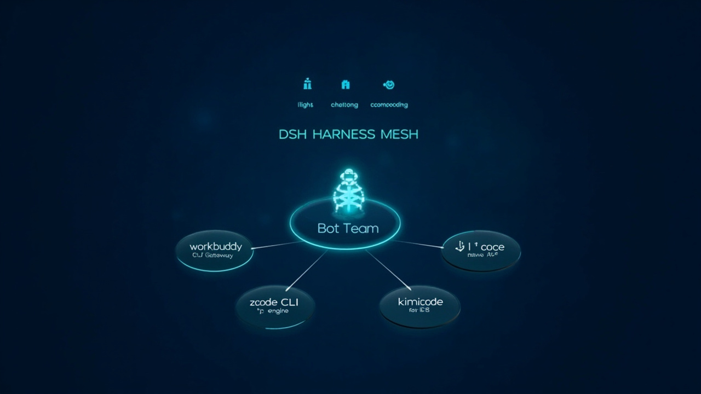

# DSH Harness Mesh

**English** · [中文](README.zh-CN.md) · [Bilingual viewer (click to switch)](index.html)

**Release date:** 2026-10-18 · **License:** MIT · **Components:** [DeepSeek Harness](https://github.com/deepseek-ai/deepseek-harness) · [DeepSeekBot](https://github.com/BotHarness/DeepSeekBot)

---

## What is this?

**DSH Harness Mesh** — a multi-harness orchestration layer for DeepSeek Harness. One control plane dispatches real work across a fleet of AI coding agents (workbuddy / zcode / kimicode / opencode), and a persistent **Bot Team** (DeepSeekBot) drives them with native tools.

```
┌─────────────────────────────────────────────────┐
│  DSB Bot Team (persistent identities + memory)  │
│         │  native harness_* tools (82 total)    │
│  ┌──────▼───────────────────────────────────┐   │
│  │  Harness Mesh  (plug protocol over ANN)  │   │
│  └──┬─────────┬─────────┬─────────┬─────────┘   │
│     ▼         ▼         ▼         ▼             │
│ workbuddy   zcode    kimicode   opencode        │
│ (GUI GW)   (CLI)     (native    (native         │
│                        ACP)       ACP)          │
└─────────────────────────────────────────────────┘
```

## Highlights

### 1. Bots that actually delegate
Every DSB bot ships with **5 native harness tools** — `harness_list`, `harness_dispatch`, `harness_status`, `harness_result`, `harness_cancel`. Ask a bot to "have zcode refactor this file" and it discovers the node, dispatches, polls, and reports back. Node configuration is a single source of truth (`nodes.json`), symlinked across instances — zero drift.

### 2. Four harness forms, one contract
The plug protocol (length-framed JSON-RPC + raw byte pipes) drives four completely different agent shapes behind one interface:

| Node | Form | Notes |
|---|---|---|
| workbuddy | GUI Gateway (REST bridge) | + UI control tools (10) |
| zcode | CLI-first, thin adapter | -p engine, auth-safe |
| kimicode | Native ACP CLI | zero adapter |
| opencode | Native ACP CLI | zero adapter |

### 3. Production hardening (this build)

- **crypto.randomUUID polyfill** — DSB's client crashes on LAN origins (non-secure context); patched at the client entry
- **Channel-body panel on click** — clicking a bot in the roster now opens the conversation (upstream progressive-migration gap)
- **One-click exit** — the Bot-mode rail icon returns to the main GUI
- **Auto Bot-mode** — deep-link entry straight into Bot mode
- **Diagnostics off by default** — no head-script crash on first paint
- **Model switching** — per-bot model presets + per-task model override (`harness_config`, `dispatch.model`)
- **systemd keepalive** — 60s watchdog, 40s self-heal (verified)
- **Direct LAN binding** — reverse proxy retired (it was a failure factory); dsh binds 0.0.0.0 with a pinned token

## Install

```bash
git clone https://github.com/BotHarness/DeepSeekBot.git BotHarness
cd BotHarness
# apply DreamX patches (see patches/ in the release bundle)
pnpm install && pnpm build
node scripts/dev-instance.mjs --home /tmp/botharness-demo --port 31967 \
  --trusted-host <your-lan-ip> --no-client-diagnostics
```

Then open `http://<your-lan-ip>:31967/?token=<DSH_WEB_TOKEN>`.

## Verified

- 24/25 headless UI traversal steps clean (the 1 "failure" is the intentional exit navigation)
- 60s connection stability, zero reconnects
- Bot → harness dispatch round-trip: PONG in 5s
- Model switch: UI picker (6 models) → save → next request uses it

## Credits

Built on [DeepSeek Harness](https://github.com/deepseek-ai/deepseek-harness) and [BotHarness/DeepSeekBot](https://github.com/BotHarness/DeepSeekBot). Patches MIT.

---

*Generated with MiniMax image-01 · Architecture infographic:*


