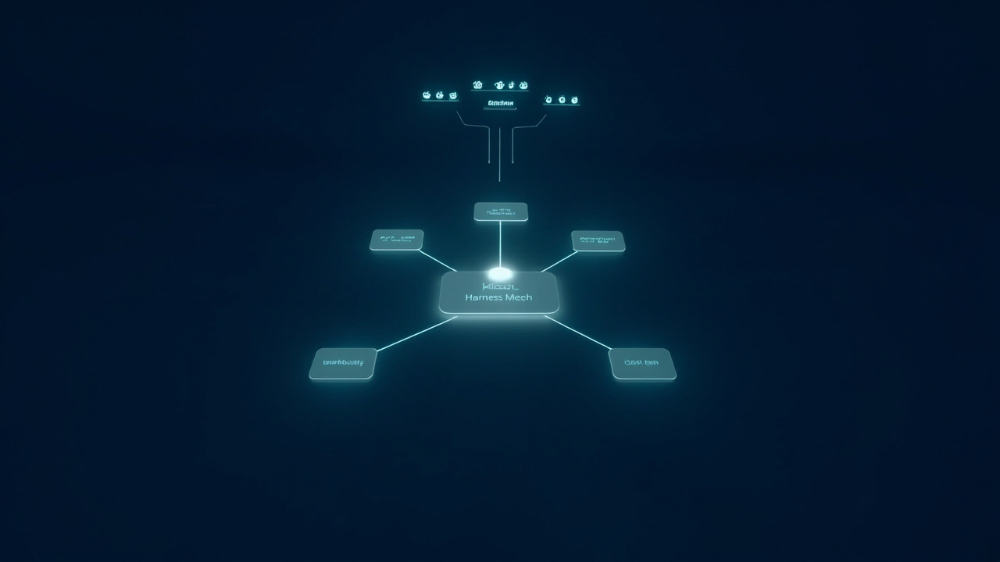
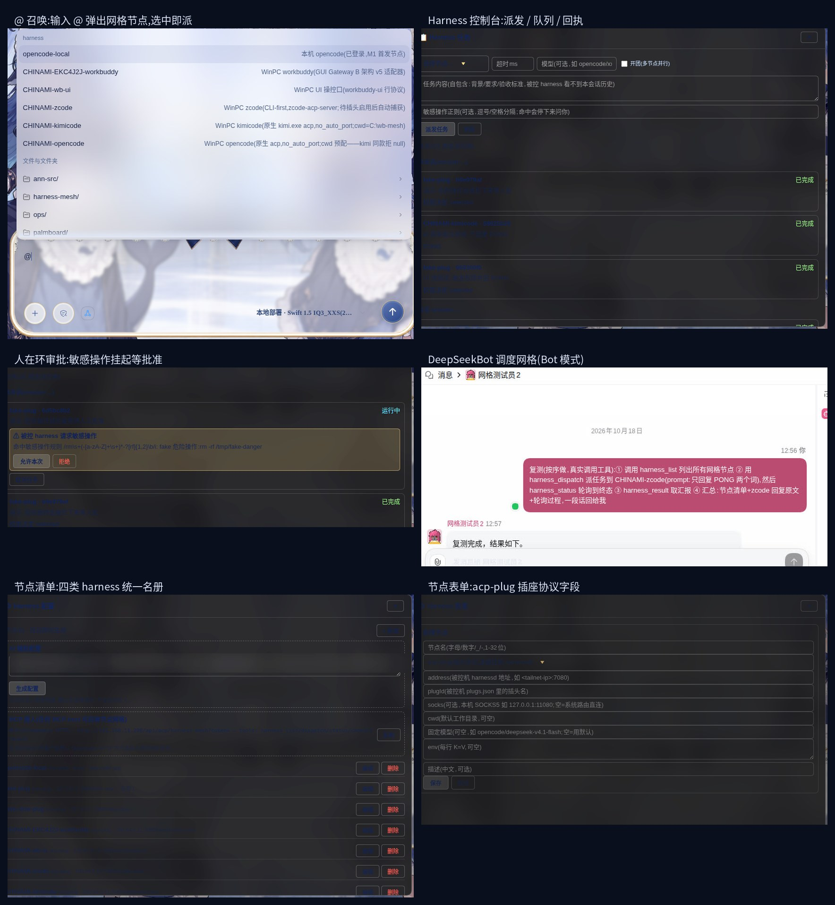

# DSH Harness Mesh

[English](README.md) · **中文** · [双语查看页(点击切换)](index.html)

**发布日期:** 2026-10-18 · **许可:** MIT · **组件:** [DeepSeek Harness](https://github.com/deepseek-ai/deepseek-harness) · [DeepSeekBot](https://github.com/BotHarness/DeepSeekBot)



---

## 这是什么?

**DSH Harness Mesh**——DeepSeek Harness 上的多 harness 调度层。一个控制面把真实工作派发到一队 AI 编程 agent(workbuddy / zcode / kimicode / opencode),并由持久化的 **Bot 团队**(DeepSeekBot)用原生工具驱动它们。

```
┌─────────────────────────────────────────────────┐
│  DSB Bot 团队(持久身份 + 长期记忆)               │
│         │  原生 harness_* 工具(共 82 个)         │
│  ┌──────▼───────────────────────────────────┐   │
│  │  Harness 网格(ANN 上的插头协议)           │   │
│  └──┬─────────┬─────────┬─────────┬─────────┘   │
│     ▼         ▼         ▼         ▼             │
│ workbuddy   zcode    kimicode   opencode        │
│ (GUI 网关)  (CLI)     (原生      (原生           │
│                        ACP)       ACP)          │
└─────────────────────────────────────────────────┘
```

## 亮点

### 1. 会真派活的 Bot
每个 DSB Bot 自带 **5 个原生 harness 工具**——`harness_list`、`harness_dispatch`、`harness_status`、`harness_result`、`harness_cancel`。对 Bot 说"让 zcode 重构这个文件",它会自己发现节点、派发、轮询、拿汇报。节点配置单一来源(`nodes.json`),跨实例软链——零漂移。

### 2. 四种形态,一套契约
插头协议(长度分帧 JSON-RPC + 原始字节管道)把四种完全不同的 agent 形态统一到一个接口后面:

| 节点 | 形态 | 备注 |
|---|---|---|
| workbuddy | GUI 网关(REST 桥) | + UI 操控工具(10 个) |
| zcode | CLI-first,薄适配器 | -p 引擎,鉴权安全 |
| kimicode | 原生 ACP CLI | 零适配器 |
| opencode | 原生 ACP CLI | 零适配器 |

### 3. 生产加固(本版)

- **crypto.randomUUID polyfill**——DSB 客户端在 LAN 源(非安全上下文)会崩,已在客户端入口修补
- **点击开对话面板**——点频道列表里的 Bot 现在会打开会话(补上游渐进迁移的缺口)
- **一键退出**——Bot 模式栏图标点一下回主 GUI
- **自动进 Bot 模式**——深链直达
- **默认关闭诊断**——首屏不再因头部脚本崩溃
- **模型切换**——每 Bot 模型预设 + 每任务模型覆盖(`harness_config`、`dispatch.model`)
- **systemd 保活**——60s 巡检,40s 自愈(已实测)
- **直连 LAN**——拆掉反代(它是个故障制造机);dsh 绑 0.0.0.0 + 固定 token


## Bot 团队(DeepSeekBot 集成)

网格通过 [DeepSeekBot](https://github.com/BotHarness/DeepSeekBot) 获得持久化的 **Bot 团队**——有身份、有记忆、**原生 harness 工具**(harness_list/dispatch/status/result/cancel)的 Bot,与网格跑在同一个 DSH 实例里。

完整指南(锁定的基线 commit、补丁、部署、已知限制):**[src/dsb-integration/INTEGRATION.md](src/dsb-integration/INTEGRATION.md)**

```bash
git clone https://github.com/BotHarness/DeepSeekBot.git BotHarness
cd BotHarness && git checkout 810ae53          # 锁定基线
git apply ../src/dsb-integration/dsb-dreamx-patches.patch
pnpm install && pnpm build
```

## 界面截图

一图六景——@ 召唤菜单、派发控制台、人在环权限审批、节点名册、节点表单(acp-plug)、DeepSeekBot 调度网格:



## 源码与构建

**本仓库只发源码,不发预编译二进制。** 下载后在自己的机器上构建。

```
src/workbuddy/    GUI 网关适配器 + 10 个 UI 操控工具
src/zcode/        CLI-first 薄适配器(-p 引擎)
src/kimicode/     原生 ACP,零适配器
src/opencode/     原生 ACP,零适配器
```

每个包的 `DEPLOY.md` 里有完整的**构建与部署**步骤(依赖、harnessd/guardian 启动、ANN 绿模、节点注册)。

被控机上需要自备:

| 包 | 需要 | 备注 |
|---|---|---|
| workbuddy | Python ≥3.10 + ann-agent(Go 1.26.3 从 ann-src/ 编) | + UI 操控工具 |
| zcode | Python ≥3.10 + zcode CLI | 薄适配器已含 |
| kimicode | Python ≥3.10 + kimi CLI(原生 ACP) | 零适配器 |
| opencode | Python ≥3.10 + opencode CLI(原生 ACP) | 需 `opencode auth login` |

打包下载:[Releases → v1.0 → 源码 zip](https://github.com/cx2002302-lang/DSH-Harness-Mesh/releases/tag/v1.0)。

## 安装

```bash
git clone https://github.com/BotHarness/DeepSeekBot.git BotHarness
cd BotHarness
# 打 DreamX 补丁(见发布包的 patches/)
pnpm install && pnpm build
node scripts/dev-instance.mjs --home /tmp/botharness-demo --port 31967 \
  --trusted-host <你的局域网IP> --no-client-diagnostics
```

然后打开 `http://<你的局域网IP>:31967/?token=<DSH_WEB_TOKEN>`。

## 验证

- 无头 UI 遍历 24/25 通过(唯一"失败"项是有意为之的退出跳转)
- 60 秒连接稳定性,零重连
- Bot→harness 派活回路:PONG 5 秒到达
- 模型切换:UI 选择器(6 个模型)→ 保存 → 下一次请求即用新模型

## 致谢

基于 [DeepSeek Harness](https://github.com/deepseek-ai/deepseek-harness) 与 [BotHarness/DeepSeekBot](https://github.com/BotHarness/DeepSeekBot)。补丁部分 MIT。

